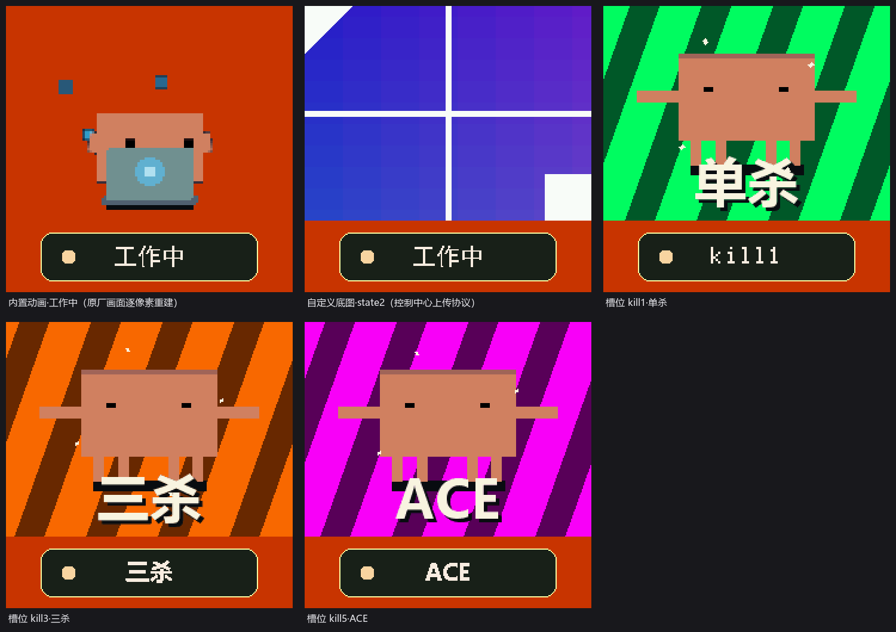

# Clawd-Mochi Toolkit

给 [Clawd-Mochi](https://abc.buildfpga.com/clawdmochi-docs/) 桌面 AI 状态桌宠做的**扩展工具箱**：把"只能显示 6 种状态"的成品小玩具，变成能播任意自定义动画、能在游戏击杀时表演、还能被二次开发的状态屏。

> 非官方项目。只做互操作（interoperability）与个人使用，不包含任何原厂固件、原厂素材或安装包，详见文末[第三方与法律说明](#第三方与法律说明)。



## 这个仓库有什么

两个互相独立、也能配合使用的部分：

| 模块 | 目录 | 一句话 |
| --- | --- | --- |
| **Hook 扩展 / 桌面侧工具** | [`ext/`](ext/README.md) | 不改固件就能做的事：扩展事件桥、DSH 插件、Claude Code 额外 hook、**CS2 击杀动画（Game State Integration）** |
| **自写固件** | [`fw/`](fw/README.md) | 换掉原厂固件：**任意多个自定义动画/图片槽位**、兼容原厂控制中心的全部 HTTP 接口、官方 USB 串口协议、串口命令行 |

两块能组合：固件提供"槽位"能力，`ext/` 里的 CS2 桥按击杀档位播放对应槽位（`kill1..kill5`、`阵亡`、`胜利`、`失败`）。

## 能力总览

### 桌面侧（`ext/`，不需要动固件）

| 能力 | 说明 |
| --- | --- |
| 扩展事件桥 `mochi_bridge.py` | 监听 `127.0.0.1:18894`，绕开原厂控制中心 `18892` 只认 7 个状态的白名单，可发全部 13 个事件名，并支持终端文字、进度条、底色/速度/背光、字幕 |
| 轻量 hook 客户端 `mochi_hook.py` | 单次 HTTP 调用就退出，替换 `powershell -EncodedCommand`（630–770 ms）后可省 ~90% 开销，单次约 35–40 ms |
| DSH 插件 `dsh-plugin/index.js` | 常驻 JS，给 DeepSeek Harness 提供更细的状态（工具名、审批内容、子代理、压缩） |
| Claude Code 额外 hook 示例 | 补齐 `Notification` / `PreCompact` / `PostCompact` / `SubagentStart` / `SubagentStop` |
| **CS2 击杀动画** `cs2_mochi.py` | 通过 CS2 官方 GSI 读击杀/爆头/多杀/死亡/回合，按 5 档 + 3 个特殊事件播放动画，带 `18895` 网页面板与手动重放 |
| 三层边界实测记录 | 哪些"加事件"其实是假的、哪些必须动固件，`ext/README.md` 里有表格和数字 |

### 固件侧（`fw/`，需要烧录）

| 能力 | 原厂 | 本固件 |
| --- | --- | --- |
| 13 种 AI 事件 → 6 组内置画面 + 休息 | ✅ | ✅（用原厂 GIF 逐像素重建，251 帧 meanDiff=0） |
| 7 个静态图片槽位（240×180） | ✅ | ✅（原厂控制中心可直接上传，协议不变） |
| **自定义动画槽位** | ❌ | ✅ **任意多个**，LittleFS 按名字存，`/event?s=kill1&h=3200` 即播 |
| 终端视图 / 画布 / 底色 / 速度 / 背光 | ✅ | ✅ |
| 截图自检 `/screenshot.bmp` | ❌ | ✅ 流式输出 240×240 BMP |
| 面板旋转/反显远程调节 `/panel` | ❌ | ✅（写 NVS 持久化） |
| 官方 USB 串口协议 | ✅ | ✅（控制中心"USB 有线"模式可用） |
| 串口命令行 | ❌ | ✅ `ip / scan / state / net / wifi / save / forget / reboot` |
| 网络诊断 `/net/get`、`/wifi/status`、`/wifi/try` | ❌ | ✅ |
| 多网络自动尝试 | ❌ | ✅（凭据放在 gitignore 的 `config_secrets.h`） |

## 架构与端口

```
AI 工具（Claude Code / Codex / DSH / ...）
   │  hook（HTTP GET）
   ▼
┌──────────────────────────── 电脑 ────────────────────────────┐
│  18892 原厂控制中心 hook 服务  18893 原厂控制台网页            │
│  18894 扩展桥 mochi_bridge.py                                  │
│  18895 CS2 桥 + 网页面板 cs2_mochi.py                          │
└──────────────┬──────────────────────┬────────────────────────┘
               │ Wi-Fi HTTP           │ USB CDC（可选）
               ▼                      ▼
        Clawd-Mochi 设备（ESP32-C3 + ST7789 240×240）
        80 端口：/ 设备控制器网页、/state、/event、/cmd、/char、
                 /speed、/redraw、/canvas、/draw/*、/backlight、
                 /images、/image/upload、/slot/upload、/screenshot.bmp ...
```

| 端口 | 谁 | 说明 |
| --- | --- | --- |
| `18892` | 原厂控制中心 | 只接受固定事件名，`/event?s=kill1` 会回 `400 invalid event` |
| `18893` | 原厂控制中心 | 控制台网页；状态在 `/api/status`（没有 `/status`） |
| `18894` | 本仓库 `ext/mochi_bridge.py` | 扩展事件桥 |
| `18895` | 本仓库 `ext/cs2_mochi.py` | CS2 GSI 接收 + 面板 `/`、`/status`、`/replay` |
| 设备 `80` | 固件 | `http://clawd-mochi.local/` |

## 快速开始

### A. 只想让桌宠"多显示点东西"（不动固件）

```powershell
cd ext
python mochi_bridge.py --port 18894          # 起扩展桥（可选 --terminal --canvas）
curl "http://127.0.0.1:18894/event?e=delegating"          # 发原厂 13 事件之外的语义
curl "http://127.0.0.1:18894/say?text=npm%20test"          # 在设备终端上打字幕
```

给 Claude Code 加更多 hook：把 [`ext/examples/claude-code-extra-hooks.json`](ext/examples/claude-code-extra-hooks.json) 合并进 `~/.claude/settings.json`。细节与踩坑见 [`ext/README.md`](ext/README.md)。

### B. 想要 CS2 击杀动画

1. 把 [`ext/cs2/gamestate_integration_clawdmochi.cfg`](ext/cs2/gamestate_integration_clawdmochi.cfg) 放进 CS2 的 `game/csgo/cfg/`，**重启游戏**生效。
2. 起桥：双击 [`ext/cs2/start.bat`](ext/cs2/start.bat)（或 `python ext/cs2_mochi.py --slots`）。
3. 打开面板 `http://127.0.0.1:18895/` 点按钮就能试播，不用进游戏。

> 击杀动画的"画面"来自固件槽位：不换固件时只能播原厂 6 组内置画面（用 `--anim-map` 指定档位映射）；换固件后可用 `kill1..kill5` 等自定义动画。详见 [`ext/README.md`](ext/README.md#6-cs2-击杀动画game-state-integration) 与 [`fw/README.md`](fw/README.md)。

### C. 想换固件（任意多个自定义动画槽位）

```powershell
cd fw
# 0) 生成资源头文件（见下节"资源头文件"）
pio run                                        # 编译
python -m esptool --chip esp32c3 --port COM11 --baud 460800 ^
    --after hard-reset write-flash 0x10000 .pio\build\clawdmochi\firmware.bin
```

- **只写 `0x10000`（app 分区）**：保留 bootloader、分区表、NVS（WiFi 凭据）、LittleFS（自定义槽位）。
- 回滚：把原厂 app 写回 `0x10000`，或整片恢复出厂备份（备份请自己做，仓库不含原厂镜像）。
- 烧录前若原厂控制中心处于"USB 有线"模式，它会独占 COM 口，先切回 Wi-Fi 模式。
- 完整参数、API 表、素材格式见 [`fw/README.md`](fw/README.md)。

#### 资源头文件（仓库不包含，需本地生成）

固件里有三个**由原厂资产生成**的头文件，出于版权与仓库体积考虑不提交，需要时用自带脚本从**你自己安装的 Clawd-Mochi** 生成：

| 生成物 | 脚本 | 来源 |
| --- | --- | --- |
| `fw/src/assets.h`（7 组内置动画的逐帧矩形表 + 状态牌位图） | `fw/tools/extract_assets.py` | 控制中心 `web_ui/assets/animations/*.gif` |
| `fw/src/web_pages.h`（设备控制器页 / 配网页） | `fw/tools/embed_pages.py` | 设备自身 `GET /` 与 `GET /wifi`（或从控制中心安装包中提取） |
| `fw/src/slot_labels.h`（槽位中文标签位图） | `fw/tools/gen_slot_labels.py` | 系统字体 `msyhbd.ttc` + 你自己的映射表 |

生成流程（Windows）：

```powershell
# 1) 解包你自己安装的 Clawd-Mochi.exe（PyInstaller onefile）
pip install pyinstxtractor-ng
python pyinstxtractor-ng "D:\Program Files (x86)\Clawd-Mochi-Windows\Clawd-Mochi.exe"
# -> 得到 Clawd-Mochi.exe_extracted\web_ui\assets\animations\*.gif

# 2) 指向解包目录生成动画表（脚本支持 --src）
python fw\tools\extract_assets.py --src "<解包目录>\web_ui\assets\animations"

# 3) 网页：设备在线时直接抓
python fw\tools\embed_pages.py --url http://clawd-mochi.local

# 4) 中文标签位图
python fw\tools\gen_slot_labels.py
```

> 三个脚本都支持 `--help`；`extract_assets.py --src <GIF目录>`、`embed_pages.py --url <设备地址>` 是仓库版新增的参数。

## 目录结构

```
Clawd-Mochi-Toolkit/
├─ README.md                # 你正在看的
├─ LICENSE                  # MIT（只覆盖本仓库代码）
├─ docs/img/                # README 用图
├─ ext/                     # 桌面侧：hook 扩展 + CS2 击杀动画
│  ├─ mochi_bridge.py       #   扩展事件桥，18894
│  ├─ mochi_hook.py         #   单次 hook 客户端（curl 级开销）
│  ├─ cs2_mochi.py          #   CS2 GSI 接收 + 面板，18895
│  ├─ cs2/                  #   GSI cfg、start/stop 脚本
│  ├─ dsh-plugin/index.js   #   DeepSeek Harness 状态插件
│  ├─ examples/             #   Claude Code 额外 hook 示例
│  └─ README.md             #   边界分析 + 实测数据 + 踩坑
└─ fw/                      # 自写固件（PlatformIO / Arduino）
   ├─ platformio.ini
   ├─ src/                  #   display / pet / web / net / main + 生成头文件（gitignore）
   ├─ tools/                #   动画提取、打包、上传、串口控制台、截图比对等
   ├─ dist/                 #   烧录/回滚脚本（镜像二进制不入库）
   └─ README.md             #   差异表、API、素材格式、实测记录、已知限制
```

## 逆向说明（为什么能做到）

- 固件内的 HTTP 路由、内嵌网页、分区表、Arduino 依赖均可从原厂镜像静态确认；`/state`、`/event`、`/images`、`/image/upload` 的语义由设备实机探测确认。
- 内置表情动画是**纯色矩形**拼的（无抗锯齿），所以能从控制中心自带的预览 GIF 逐帧重建为"矩形表"，251 帧重绘校验 `meanDiff = 0.000`；其中「休息中」的 GIF 第 1..35 帧是局部帧，必须用 `fw/tools/gif_compose.py` 叠加合成（这是 0.1.1 修复的 bug）。
- 屏幕是 1.54" ST7789 240×240：舞台（画面）占 0–179，底部 60px 由固件画状态牌；面板旋转 2 + 反显（`inv=1`）是正确配置。
- 引脚（最新硬件）：`MOSI GPIO3 / SCK GPIO4 / DC GPIO5 / RST GPIO6 / BL GPIO7 / CS GPIO8`。

## 已知限制

- 只针对 **Wi-Fi 版** ESP32-C3 4MB 固件验证过；USB / BLE 版硬件未测试（USB 协议已在 Wi-Fi 版硬件上实现并实测可用）。
- 内置动画矩形表每帧 1,100–1,400 个矩形，C3 上的实际帧率未做严格测量（截图验证的是正确性）。
- 原厂控制中心只认自己的事件名，所以"自定义槽位"必须由你自己的脚本/桥直接打设备 HTTP。
- 校园网/企业网常做客户端隔离：电脑→设备可能不通（设备→电脑通常通）。这时要么用 USB 有线模式，要么自建"设备轮询"通道。
- 原厂固件没有源码；本项目是黑盒互操作实现，固件升级后原厂行为变化可能导致不兼容。

## 第三方与法律说明

- **Clawd-Mochi** 是第三方产品，本项目与原作者无关；文档与固件镜像版权归原作者。
- 本仓库**不包含**：原厂固件镜像、原厂安装包、从原厂资产提取的图片/网页/字模（这些会被 `.gitignore` 排除，由上述脚本在你本地生成）。
- `ext/` 与 `fw/src/*.cpp|h`、`fw/tools/*.py` 等自制代码以 MIT 许可发布（见 `LICENSE`）。MIT **不覆盖**第三方商标、原厂素材与任何你自行提取的资源。
- 刷固件有风险（可能变砖、丢 WiFi 配置/自定义素材）。请先自行整片备份，风险自负。

## 版本与发布（Tags & Releases）

仓库按"固件版本 + 工具集版本"打标签：

| 标签 | 内容 |
| --- | --- |
| `v1.0.0` | 工具箱首个版本（`ext/` + `fw/` 源码 + 文档） |
| `fw-v0.1.4` | 当前固件里程碑（源码 tag；预编译镜像请自行 `pio run` 生成） |

更早的固件里程碑（0.1.0-inv / 0.1.1-sleepfix / 0.1.2）见 [`CHANGELOG.md`](CHANGELOG.md)，不再单独打 tag。

发布步骤（一次性）：

```powershell
cd <repo>
git init
git add .
git commit -m "Clawd-Mochi Toolkit: hook extensions, CS2 kill animations, custom firmware"
git branch -M main
git remote add origin https://github.com/ttbr5145/Clawd-Mochi-Toolkit.git
git push -u origin main
git push origin --tags
```

然后在 GitHub 网页 `Releases → Draft a new release` 选对应 tag，Release note 直接复制
[`CHANGELOG.md`](CHANGELOG.md) 里对应小节即可（说明见 `fw/README.md` §0 版本历史）。

> Release 里**不放**原厂固件、预编译自定义固件或任何原厂素材：前者是第三方版权物，后者包含从原厂素材
> 生成的资源。需要固件的人按 README 的步骤本地生成资源 + `pio run` 即可。

## License

[MIT](LICENSE) © ttbr5145 and Clawd-Mochi Toolkit contributors

> MIT 只覆盖本仓库自写代码。Clawd-Mochi 产品、固件、素材版权归原作者；详见
> [第三方与法律说明](#第三方与法律说明) 与 `LICENSE` 末尾的 scope 说明。
'